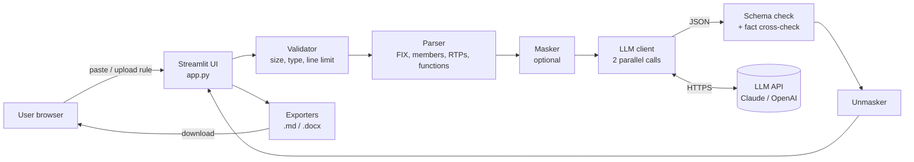

# Architecture Notes — EPM Business Rule Documentation Generator

**Version:** 0.2 (MVP) · **Related:** `spec.md`

## 1. Overview

A single Python web app. Deterministic code (parser, masking, exporters) handles everything that must be exact. The LLM handles only the writing: the explanation of the rule's purpose and logic. The UI and the core logic are kept in separate modules, so the UI can later be swapped for an API (FastAPI) without rewriting the logic.



## 2. Tech stack

| Layer | Choice | Why |
|---|---|---|
| Language | Python 3.12 | Easiest to learn; strong text and document libraries |
| UI | Streamlit | Tabs, file upload, text areas and download buttons built in; no HTML/JS needed for the MVP |
| Data models | Pydantic v2 | Validates the LLM's JSON against the schemas in `spec.md` §5 |
| LLM SDK | `anthropic` (or `openai`) | Chosen by env var; wrapped behind one interface |
| Word export | `python-docx` | Generates .docx without Microsoft Office |
| Tests | `pytest` | Simple, standard |
| Lint | `ruff` | Fast; one tool for lint and format |
| CI/CD | GitHub Actions | Required deliverable; runs lint + tests on every push |
| Hosting | Render (web service, free tier) | Deploys from GitHub automatically; supports Streamlit; HTTPS included |

## 3. Repository structure

```
epm-rule-doc-generator/
├── app.py                    # Streamlit UI only (no business logic)
├── core/
│   ├── __init__.py
│   ├── validator.py          # line limit, empty/binary checks, warnings
│   ├── detector.py           # calc_script vs groovy
│   ├── parser_calc.py        # FIX/ENDFIX stack, members, RTPs, functions, commands
│   ├── parser_groovy.py      # rtps.*, embedded calc strings, grid/data map calls
│   ├── masker.py             # mask / unmask member names
│   ├── llm_client.py         # provider wrapper, retries, caching
│   ├── prompts.py            # system prompts and templates
│   ├── schemas.py            # Pydantic models for both outputs
│   ├── checks.py             # cross-check AI output against parser facts
│   ├── exporters.py          # to_markdown(), to_docx()
│   ├── telemetry.py          # usage log + counters (metadata only)
│   └── pipeline.py           # runs the whole request lifecycle (§4)
├── tests/
│   ├── samples/              # sample rules (no client data)
│   ├── conftest.py           # forces mock LLM: tests never call a real API
│   ├── test_parser_calc.py
│   ├── test_parser_groovy.py
│   ├── test_detector_validator.py
│   ├── test_masker.py
│   ├── test_llm_and_pipeline.py   # retries, mock pipeline, exporters
│   └── test_telemetry.py     # monitoring; proves logs hold no rule text
├── .github/workflows/ci.yml
├── .streamlit/config.toml
├── pyproject.toml            # ruff + pytest settings
├── requirements.txt
├── render.yaml               # Render deployment config
├── .env.example              # variable names only, no values
├── CLAUDE.md                 # instructions for AI coding assistants
├── .cursorrules              # same rules for Cursor
├── docs/                     # reflection, demo script, v2 issue, submission checklist
├── spec.md
├── architecture.md
└── README.md
```

## 4. Request lifecycle

1. **Validate** (`validator.py`): reject empty or binary input; count lines; > 2,000 → error; > 1,000 → warning banner.
2. **Detect** (`detector.py`): set `rule_type`; user can override in the UI.
3. **Parse** (`parser_calc.py` / `parser_groovy.py`): produce a `RuleFacts` object (FIX blocks with depth and line numbers, members, RTPs, functions, commands).
4. **Mask** (`masker.py`, optional): replace member names with `MBR_001`…; keep the map in memory for this request only.
5. **Generate** (`llm_client.py`): send system prompt + `RuleFacts` JSON + numbered rule text. Run the documentation call and the "Teach me" call in parallel (`concurrent.futures`).
6. **Validate output** (`schemas.py`): parse into Pydantic models; on failure retry once with the error message appended; then show a friendly error.
7. **Cross-check** (`checks.py`): flag any member in the AI's FIX scope that the parser did not find.
8. **Unmask**, then render three tabs: Documentation, Extracted facts, Teach me.
9. **Export** (`exporters.py`): build .md or .docx from the (possibly edited) sections.
10. **Record** (`telemetry.py`): one JSON log line per run (outcome, duration, rule type, line count) and update the sidebar counters. Rejected inputs and AI errors are recorded too.

## 5. Key design decisions

| Decision | Reason | Trade-off |
|---|---|---|
| Code extracts facts; AI only writes explanations | Reduces made-up members and scopes; gives users something to verify against | Parser needs maintenance as new syntax appears |
| Structured JSON output, not free text | Same sections every time; easy to export and test | Slightly more prompt work; needs validation and retry |
| Two parallel LLM calls | Faster than one huge call; "Teach me" can fail without losing the documentation | Two API calls per rule |
| Stateless, no database | Simplest; strongest privacy story (nothing stored) | No history; user must export before closing |
| Streamlit for UI | Fastest way for a learner to ship a working UI | Less design control; core logic kept separate so it can move to FastAPI + React later |
| Provider-agnostic LLM wrapper | Can switch to a firm-approved AI endpoint later | Small extra abstraction |

## 6. Security and privacy

- `LLM_API_KEY` stored as a Render environment variable and a GitHub Actions secret; never in code or logs.
- Rule text, outputs and masking maps live only in memory for the request (Streamlit session state); nothing written to disk or a database.
- Logging records only metadata: rule type, line count, response time, success/failure.
- Masking (FR-4) recommended for any real project rules; README states that only sample or anonymised rules should be used.
- LLM provider's data-retention terms noted in the README.

## 7. Configuration

| Variable | Example | Purpose |
|---|---|---|
| `LLM_PROVIDER` | `anthropic` | `anthropic`, `openai`, or `mock` (no API call; used in tests and demo mode) |
| `LLM_MODEL` | `claude-haiku-5-5` | Model name |
| `LLM_API_KEY` | (secret) | API key |
| `MAX_LINES` | `2000` | Hard input limit |
| `WARN_LINES` | `1000` | Warning threshold |
| `LLM_TIMEOUT_SECONDS` | `90` | Per-call timeout |

## 8. CI/CD

**GitHub Actions (`.github/workflows/ci.yml`)**, on every push and pull request to `main`, two jobs:
1. **secret-scan** – gitleaks scans the full commit history for leaked keys.
2. **lint-and-test** – set up Python 3.12, install requirements, `ruff check .`, `pytest -q` (LLM mocked, so no API key or cost), and an import smoke test.

**Deployment:** Render watches `main`. When CI passes and code is merged, Render rebuilds and redeploys automatically. Start command:
`streamlit run app.py --server.port $PORT --server.address 0.0.0.0`

## 8a. Monitoring

| What | Where to see it |
|---|---|
| One JSON line per generation (`{"event":"generate","outcome":"success","duration_s":4.2,...}`) | Render dashboard → **Logs** |
| Runs, success rate, average time, rule types (since last restart) | App sidebar |
| CPU, memory, restarts | Render dashboard → **Metrics** |
| Uptime | Render health check on `/_stcore/health` |

Counters reset when the app restarts (no database by design). Rule text is never logged; a unit test enforces this.

## 9. Future architecture (beyond MVP)

- **API split:** move `core/` behind FastAPI; React or Next.js front end on Vercel.
- **Long rules:** split by FIX block or Groovy method, document each part, then merge.
- **Whole-application mode:** accept an LCM snapshot, parse all rules, build a rule → intersection dependency graph.
- **Enterprise deployment:** Docker image for self-hosting with a customer-owned LLM endpoint.
